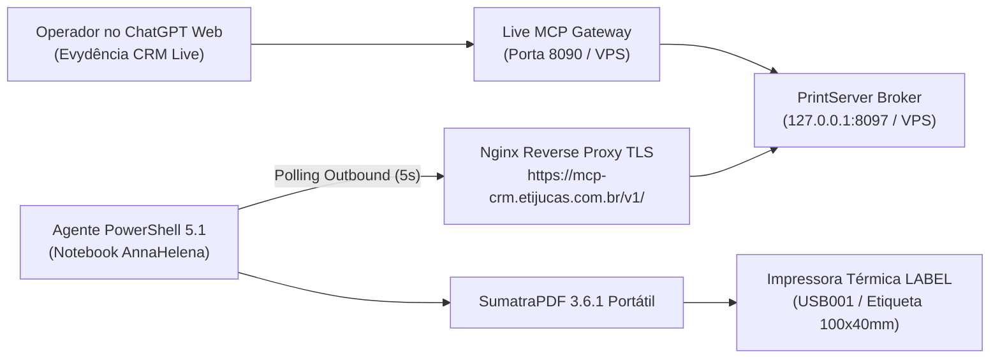

# Evydência PrintServer — Fila LABEL no AnnaHelena

Servidor de fila e agente Windows PowerShell para impressão automatizada de etiquetas adesivas térmicas **100 × 40 mm** na impressora térmica `LABEL` (USB001) via SumatraPDF portátil. 

Projeto 100% independente do Laravel e do EvydFlow. Sem PrintNode, sem mensalidades e **sem portas de entrada no notebook** (polling outbound HTTPS).

---

## 1. Topologia em Produção



> [!IMPORTANT]
> **Segurança e Isolamento Inegociáveis:**
> - **Zero escrita no CRM:** O MCP apenas solicita a impressão de um pedido se o status **já estiver gravado como 10** (`waiting_product_retrieve`) e com **saldo zerado** (`remaining_cents === 0`).
> - **Sem baixas via endpoint legado:** O endpoint `PUT /api/orders/status` permanece proibido. A baixa física do malote deve ser feita pelo operador na interface web do CRM antes da solicitação da etiqueta.
> - **Zero disparos de WhatsApp** e zero mutações de banco de dados.
> - **Zero portas abertas:** O notebook opera estritamente enviando requisições saintes HTTPS para a VPS.

---

## 2. Homologação Física Concluída (26/10/2026)

A impressora física `LABEL` conectada na porta `USB001` do notebook `ANNAHELENA` foi calibrada e homologada em produção.
Consulte o dossiê completo em [docs/AUDITORIA_FORENSE_HOMOLOGACAO_20261026.md](docs/AUDITORIA_FORENSE_HOMOLOGACAO_20261026.md).

### Destaques da Calibração:
- **Mídia no Subsistema Win32 GDI:** `paperkind=205`, Nome: `Etiqueta`, Dimensões: `100.0 x 40.0 mm`.
- **Padrão do Driver Preservado:** O padrão de fábrica de 150 mm (`Option8`) não foi alterado no registro do Windows; a fita de 40 mm é forçada pelo parâmetro explícito `paper=Etiqueta` na chamada do SumatraPDF.
- **Layout Calibrado (`src/pdf.mjs`):**
  - Todas as 4 linhas com a fonte `Helvetica-Bold` (`/F2`) para queima térmica preta e nítida.
  - Moldura com traço `1.0 w` e recuo inferior de $10\text{ pt}$ ($3.5\text{ mm}$).
  - Linha inferior `DISPONIVEL PARA RETIRADA` elevada para $y=24\text{ pt}$ (~$8.5\text{ mm}$ do corte), garantindo que a serra serrilhada de destaque nunca encoste no texto.
  - Margens horizontais centralizadas em $16\text{ pt}$ ($5.6\text{ mm}$).
- **Compatibilidade PowerShell 5.1:** Parâmetro `$ConfigPath` em `windows/agent.ps1` com resolução pós-binding.
- **Telemetria de Produção:**
  - Polling a cada 5 segundos via HTTPS com latência de $\approx 47\text{ ms}$.
  - Tempo total de ciclo de impressão: **2,73 segundos** entre a submissão no broker e a finalização no buffer USB.

---

## 3. Componentes do Repositório

- `src/broker.mjs`: API ultraleve em Node.js com autenticação Bearer separada para MCP (`PRINTSERVER_MCP_TOKEN`) e Agente (`PRINTSERVER_AGENT_TOKEN`). Fila persistente em JSON com tombstones permanentes (`seen_arrival_orders`) e descarte imediato do PDF após entrega para privacidade.
- `src/pdf.mjs`: Gerador de PDF vetorial monofolha 100 × 40 mm, em ASCII puro, sem dependências npm.
- `src/server.mjs`: Servidor HTTP com bind restrito a loopback (`127.0.0.1:8097`).
- `windows/agent.ps1`: Agente Windows PowerShell 5.1 para polling outbound, validação de integridade SHA-256 e acionamento do SumatraPDF em modo silencioso.
- `windows/install-task.ps1`: Script para registrar a tarefa agendada no logon da usuária (`RunLevel Limited`, sem privilégios administrativos).
- `scripts/Prepare-SumatraPortable.ps1`: Instalador do SumatraPDF 3.6.1 portátil oficial com validação de checksum SHA-256.
- `scripts/Test-LabelPrinter.ps1`: Script de diagnóstico somente leitura para validação da fila e do formulário `Etiqueta`.
- `windows/Invoke-SyntheticPrintTest.ps1`: Disparador controlado de 1 impressão sintética de teste com trava de segurança (`-AuthorizeSinglePrint`).

---

## 4. Guia Rápido de Instalação e Operação

### No Servidor VPS (`185.241.151.207`):
1. O broker roda sob systemd: `systemctl status evydencia-printserver.service`.
2. As variáveis de ambiente ficam em `/etc/evydencia-printserver/broker.env` (permissão `0640` restrita ao usuário `evydmcp`).
3. O Nginx atua como proxy reverso em `https://mcp-crm.etijucas.com.br/v1/`.

### No Notebook do Operador (`AnnaHelena`):
1. O executável fica em `C:\Evydencia\printserver\SumatraPDF.exe`.
2. O segredo do agente fica em `C:\Evydencia\printserver\agent-token.txt` (permissão restrita ao usuário logado via `icacls`).
3. O arquivo `windows/config.local.json` define:
   ```json
   {
     "broker_url": "https://mcp-crm.etijucas.com.br",
     "secret_file": "C:\\Evydencia\\printserver\\agent-token.txt",
     "sumatra_path": "C:\\Evydencia\\printserver\\SumatraPDF.exe",
     "printer": "LABEL",
     "paper": "Etiqueta",
     "enable_printing": true,
     "poll_seconds": 5,
     "calibration_confirmed_100x40": true
   }
   ```
4. A tarefa agendada `Evydencia - PrintServer LABEL` inicia automaticamente no login.

---

## 5. Referências e Padrões
- SumatraPDF CLI: https://www.sumatrapdfreader.org/docs/Command-line-arguments
- Windows Print Management: https://learn.microsoft.com/en-us/powershell/module/printmanagement/
- Microsoft Task Scheduler: https://learn.microsoft.com/en-us/powershell/module/scheduledtasks/
- MCP Specification: https://modelcontextprotocol.io/specification/2025-06-18/
